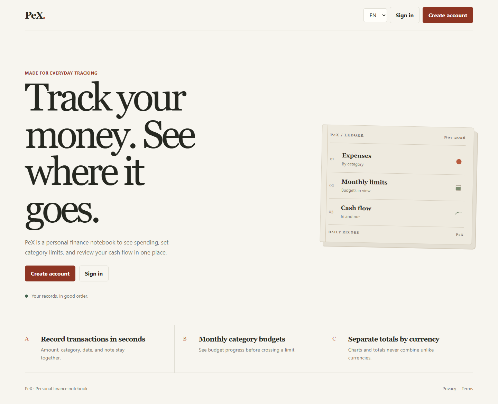
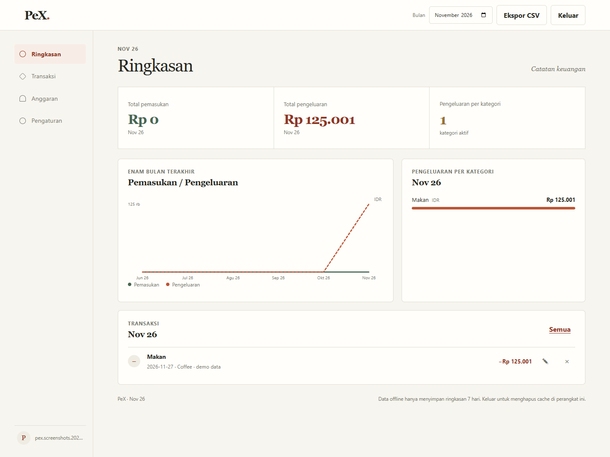
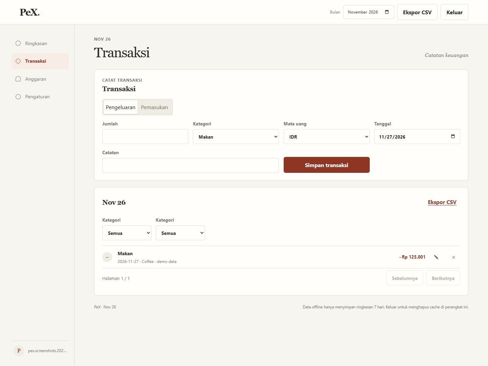
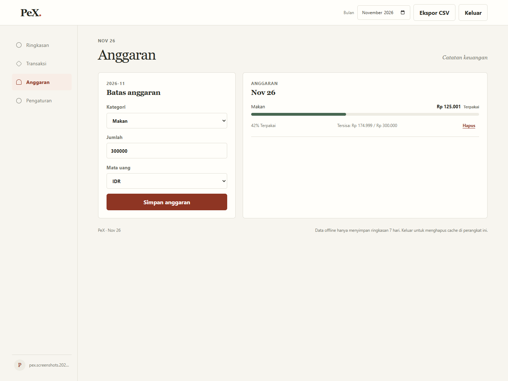
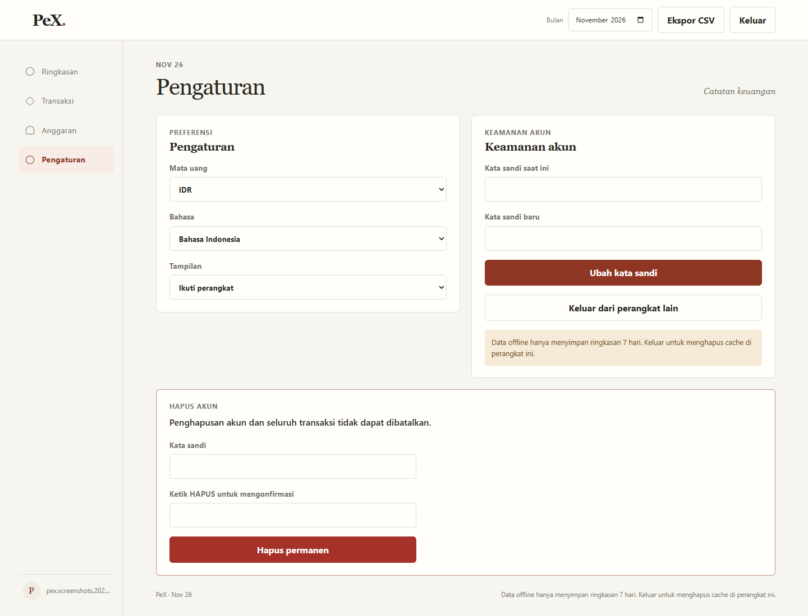

# PeX

PeX is a personal expense tracker and monthly budget planner. It keeps income and expenses, category budgets, and summaries in one place, with totals kept separate by currency.

## Features

- Email and password accounts with account-scoped records
- Add, edit, filter, paginate, and delete income and expense transactions
- Monthly category budgets with spending indicators
- Monthly summaries and six-month trends, grouped by currency (IDR, USD, EUR)
- CSV export with spreadsheet-formula escaping
- Indonesian and English interface
- Light, dark, and system appearance
- Installable PWA shell; offline storage is limited to a per-account summary snapshot, retained for up to seven days

Offline transaction editing, email verification, password recovery, email changes, and currency conversion are not supported. Forgotten passwords cannot be recovered.

## Stack

- React, TypeScript, Vite, Tailwind CSS
- Cloudflare Pages Functions, Hono, Zod
- Cloudflare D1

PeX does not use Workers KV.

## Requirements

- Node.js 22.12 or newer
- npm
- Wrangler (installed through the project dependencies)

## Local development

1. Install dependencies:

   ```sh
   npm install
   ```

2. Create the local D1 database and set its ID in `wrangler.toml`:

   ```sh
   npx wrangler d1 create pex-db
   ```

   Replace the placeholder `database_id` with the ID from Wrangler.

3. Apply the local schema:

   ```sh
   npm run db:migrate:local
   ```

4. Create `.dev.vars` in the project root. Keep it out of version control:

   ```dotenv
   JWT_SECRET="replace-with-a-random-secret-at-least-32-bytes-long"
   ```

5. Build the client and start Pages Functions locally:

   ```sh
   npm run build
   npx wrangler pages dev dist
   ```

   Open the local URL printed by Wrangler. `npm run dev` starts Vite for frontend-only work; API requests need a running Pages Functions server.

6. Run checks:

   ```sh
   npm test
   npm run build
   ```

The integration test starts a local Pages Functions server. Set `WRANGLER_PERSIST_TO` to a local Wrangler persistence directory that already contains the PeX schema if your local D1 state is not initialized. For a clean setup, apply the schema first with `npm run db:migrate:local`.

## Cloudflare Pages deployment

1. Create a D1 database named `pex-db` and put its database ID in `wrangler.toml`.
2. Apply the schema to the remote database:

   ```sh
   npm run db:migrate:remote
   ```

3. Configure the production secret:

   ```sh
   npx wrangler pages secret put JWT_SECRET
   ```

   Use a unique, randomly generated value with at least 32 bytes. Never commit `.dev.vars`, `.env`, or production secrets.

4. Build and deploy:

   ```sh
   npm run build
   npx wrangler pages deploy dist
   ```

Create or select the Pages project in Cloudflare before deployment. The checked-in `wrangler.toml` deliberately has a placeholder database ID and is not deploy-ready until it is replaced.

## Data and privacy notes

- Transactions, budgets, and sessions are stored in D1 and scoped by the authenticated account.
- Signing out clears the current account's local summary cache on that device.
- Account deletion removes the account and associated records. This action cannot be undone.
- `public/privacy.html` and `public/terms.html` are starter drafts, not legal advice. Add the operator's identity and support contact, then arrange legal review before opening public registration.

## Screenshots

Landing page preview, captured from the local app:



Additional views, captured locally with synthetic demo data:

| Dashboard | Transactions |
| --- | --- |
|  |  |

| Budgets | Settings |
| --- | --- |
|  |  |

The screenshots contain a local demo email and synthetic transactions, not real financial records.

## Project structure

```text
functions/       Cloudflare Pages API and shared domain helpers
migrations/      D1 schema
public/          PWA assets and policy drafts
src/             React application and styles
tests/           Domain and API integration checks
```

## License

No license is included yet. All rights reserved unless the repository owner adds a license.
